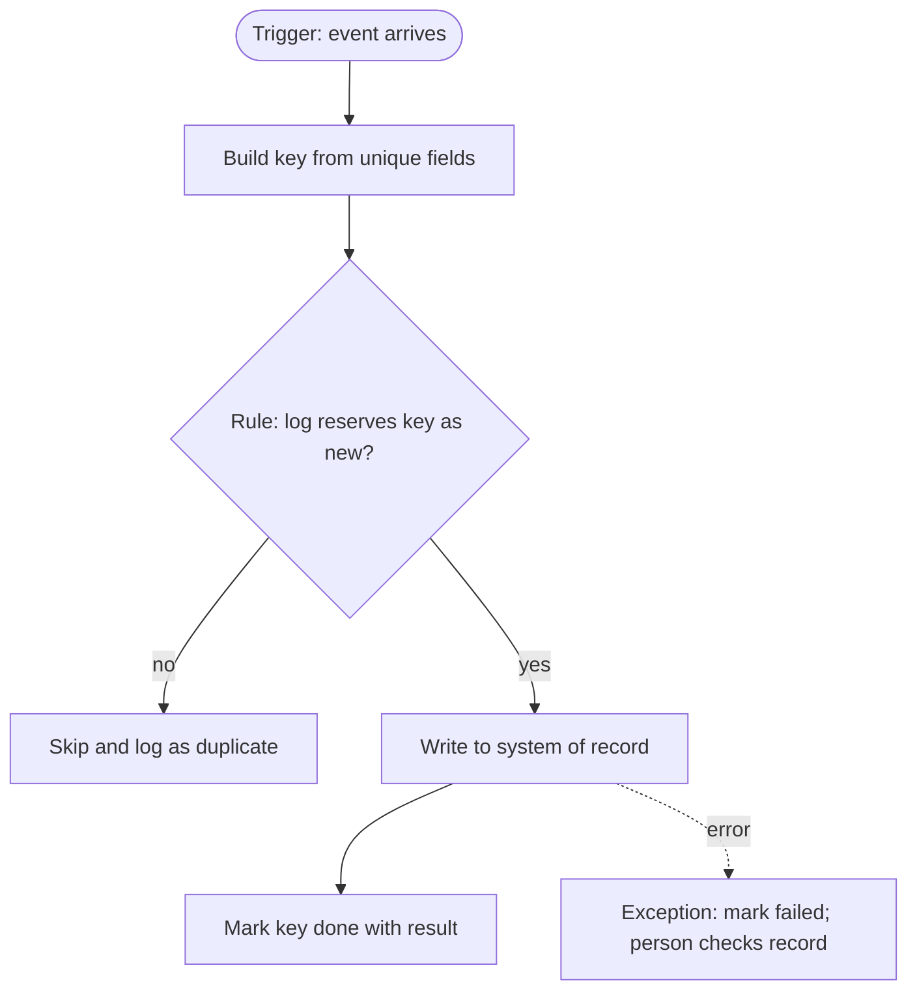

# Pattern: the duplicate-safe write

Every recipe that says "duplicate-safe write" means this pattern (book Figure 2.1).
Use it before every write to a system of record.
It is tool-neutral; the platform notes at the end say which settings bear on it.

The same event will arrive more than once.
A sender that hears no reply quickly enough sends a webhook again, so acknowledge receipt first and do the slow work afterward.
A platform retries a step that timed out though it succeeded; a person replays a failed run; a poll re-reads an edited record.

**Idempotency key:** a value naming one effect a workflow must cause only once, such as one booking per paid order.
Every copy of the same event yields the same key, so a copy can be spotted and skipped.
A step is *idempotent* when running it twice has the same result as running it once.

## The four moves, in order

1. **Build the key.**
   Use the sender's own event ID where it provides one, because it is the same on every copy.
   Otherwise combine the business fields that make the effect unique, such as source system, order ID and event type: `<source>-<order ID>-<event type>`, for example `shop-48213-order-paid`.
   Never put a delivery, receipt or last-modified time in the key, because each can differ between copies; if a time belongs at all, it is when the source created the event, in one stated time zone.
2. **Reserve the key, in one step.**
   Before anything else, add the key to the key log, marked "in progress".
   The log must refuse a second copy in that same step, as a table whose key column rejects duplicates does; if it refuses, skip the event and record a duplicate.
   If your log cannot refuse a duplicate itself, have the workflow handle one event at a time.
3. **Write once, then mark it done.**
   Turn off automatic retries on any step that writes to a system of record; reads and AI calls may still retry, for example three times.
   Write, then mark the key "done" with the result, such as the returned booking number.
4. **Hand failures to a person.**
   If the write fails, mark the key "failed" and send the event to the exception queue, a list of stuck items that a named person works through.
   A write that timed out may still have succeeded, so that person checks the system of record first, then marks the key done with its result or releases it once the cause is fixed.

## Rules

- Reserving first handles the awkward case: if a run times out before marking the key done, a resend finds it "in progress" and stops; a key left "in progress" too long goes to the exception queue.
- Where the target system allows it, also store the key on the record you create and look it up there first; that catches even a retry you could not switch off.
- A duplicate is not an update: a changed date or a cancellation takes its own update path, never the step that creates the record.
- Events can also arrive out of order; see [`../error-handling/`](../error-handling/README.md).
- Where one run writes to two systems, give each effect its own key, so recovery replays only the missing one.
- A workflow that writes to a spreadsheet still needs the duplicate-safe write.
- The duplicate case is one of the four golden-set cases every recipe must pass: one event sent twice gives one result and one logged duplicate.

## The key log

The key log is the workflow's own record of keys it has handled.
It is a small table of your own, not a plain spreadsheet, which cannot refuse a second copy.

| Column | Holds |
|---|---|
| Key | The idempotency key; the column rejects duplicates |
| Status | `in progress`, `done` or `failed` |
| Time | When the key was reserved |
| Result | The result of the write, such as the returned record number, or the failure |
| Record created | The record in the system of record, if any |

Duplicates can arrive late, so the key log must outlast the platform's run history (each platform's window is on its card in [`platforms/`](../../platforms/README.md)).
By default, keep the key log and the decision log for 13 months, a full year plus the month a year-end question usually arrives in (book Chapter 3); write the period on the governance card.
Keep one key log per client if you build for several companies.

The book's Example 2.2 shows the three states after a retest (Northstar is fictional; the rows are modeled):

| Key | Status | Result | Copies skipped |
|---|---|---|---|
| shop-48213-order-paid | done | Booking number stored | 1 |
| shop-48219-order-paid | failed | In the exception queue | 0 |
| shop-48220-order-paid | in progress | Still writing | 0 |

## Testing it

Two copies one second apart test only the simplest case; test three versions (book Chapter 16):

1. The same event twice, close together, as a sender that heard no reply would send it.
2. The same event a day later, as a platform replay or a person re-running a failed batch would send it.
3. The same event while the first run is still writing, which tests "reserve the key, in one step".

Each must produce one record and one logged duplicate; if your platform makes the third hard to start, test it once by hand and record it.

## Platform notes, as of October 2026

Checked 2026-10-12; see the [platform cards](../../platforms/README.md) for current facts.

- n8n: the Remove Duplicates node can drop items processed in previous executions; it is a filter, not a key log, so if used it sits behind the key log, never instead of it.
- n8n: Retry On Fail repeats a failed step inside the run, never returning to move 2, so leave it off on the write step.
- Zapier: Autoreplay (Professional, Team and Enterprise plans; not Free) replays errored steps and is set per Zap or account-wide; turn it off on a Zap whose step writes to a system of record.
- Power Automate: check each write action's retry setting and turn retries off there.
- Power Automate keeps run history for 30 days, so a duplicate on day 31 finds nothing there.

None of these replaces knowing your key.

## Source

*AI Workflows That Run the Business*, Chapter 2 (the duplicate-safe write, Figure 2.1), Chapter 3 (log retention) and Chapter 16 (testing the duplicate case).
