# Pattern: error handling

Three answers cover almost every failure: retry, skip, or hand to a person.
Choose them while you build, not when a customer calls.
This pattern is tool-neutral; the table near the end maps each answer to each platform's control.

## The three answers

- **Retry** a temporary failure on a step that changes nothing: a timeout on a read, a "too many requests" reply, a system briefly unavailable.
- **Skip** a confirmed duplicate, logged, or one bad item in a batch, parked in the exception queue while the rest carries on.
  Only an item that touches no money, no customer and no employee record is safe to skip; a failed payment line or customer reminder is never "one bad item".
- **Hand to a person** everything else: an expired login, a missing record, any item not safe to skip, anything unrecognized.
  The workflow stops and alerts the owner.

```mermaid
flowchart TD
  A([A step fails]) --> B{Temporary, on a read-only step?}
  B -->|yes| R[Retry: 3 tries, growing waits]
  B -->|no| D{Duplicate of an earlier run?}
  D -->|yes| S[Skip: log the duplicate]
  D -->|no| F{Bad item, safe to skip?}
  F -->|yes| Q[Skip: item to exception queue]
  F -->|no| P[Hand to a person: stop, alert owner]
  R -.->|still failing| P
```

## Rules that keep each answer safe

- **Retry with a limit and a growing wait.**
  A retry with no limit runs all night.
  The book's default is three tries a step, with growing waits such as 1, 5 and 15 minutes; then the workflow stops and tells the owner.
  The whole run also stops after three consecutive failed items.
  If your platform's retry uses one fixed wait, add a wait step and a counter.
  Never retry an AI step because you disliked the answer; that is a design problem.
- **Writes follow the [duplicate-safe write](../duplicate-check/README.md).**
  Automatic retry stays off on every write to a system of record (on Zapier, for the whole Zap); a stuck or failed write goes to the exception queue for a person, as the recovery table below sets out.
  Where one run writes to two systems, give each effect its own key, so recovery replays only the missing one; an effect that cannot be undone gets a compensating action a person approves, such as canceling the extra booking, never a silent retry.
- **Never skip silently.**
  Every skip logs what, why and when; its exception queue needs an owner and an alert for items over two working days old.
- **Let the error decide.**
  Hand an authentication error to a person at once: retrying will not fix it and may lock the service account.

## Events that arrive in the wrong order

Senders retry at different times, so an older event can arrive after a newer one.
Two rules handle it.

- **Never apply an older event over a newer one.**
  Store, for each record, when the source created the last event you applied (not when it reached you), and skip and log as stale any event created earlier; with no creation time, use the source's sequence number or re-read the record before updating.
- **Hold an update whose record does not exist yet.**
  Check again after a short wait; if the record is still missing, send the update to the exception queue.

Add one out-of-order case to the golden set of any workflow that takes updates.

## Recovering after an outage

Work each key in the key log by its state; replay nothing blindly.
Where the target cannot hold the key, use the source's own reference, such as the order number.

| Key state after the outage | What you check | What you do |
|---|---|---|
| Done | Nothing | Leave it; the resent copy is logged as a duplicate |
| In progress, effect found | A target record carrying the key, or the source's own reference | Mark the key done, with that record's number |
| In progress, no effect found | No such record, on a second check a few minutes later | Release the key, then replay the event from the exception queue |
| Failed | Its entry in the exception queue | Work it from the queue |
| Any doubt | Neither check settles it | Hand it to a person; replay nothing |

Then run the workflow's golden set before telling the owner the workflow can be trusted again.
The step-by-step recovery for each workflow goes in its runbook ([`governance/runbook.md`](../../governance/runbook.md)).

## The same decisions in each platform's vocabulary, as of October 2026

Checked 2026-10-12, as each vendor documents them; see the [platform cards](../../platforms/README.md) for current facts.

| Platform | Retry a temporary error | Skip one item and go on | Hand to a person |
|---|---|---|---|
| n8n | Retry On Fail on the step | On Error set to continue, or an error output to the exception queue | One error workflow, started by the Error Trigger, attached to every workflow |
| Make | Retry handler (formerly Break) | Skip handler (formerly Ignore) | An error-handler route that alerts the owner |
| Zapier | Autoreplay on Professional, Team and Enterprise: five tries over about 10 hours 35 minutes, per Zap or account-wide, never per step | A custom error handler that sends the item to the exception queue | A custom error handler that alerts the owner |
| Power Automate | Not confirmed as of October 2026 | Configure run after on the next step | Try, Catch and Finally scopes; Catch alerts the owner |

- Zapier's last autoreplay comes too late for a same-day job, so turn it off for such a Zap and alert a person.
- Power Automate's default retry for an action is not confirmed, so check each write action's retry setting on your tenant and turn it off.

### The platform may switch a failing workflow off

As of October 2026, the Make platform disables a webhook scenario after one error and other scenarios after three consecutive errors.
Zapier turns a Zap off at 95% failures over seven days, and Power Automate turns a flow off after 14 days of errors.
No n8n rule is confirmed; check your own instance.

That stops an endless loop, but a stopped workflow goes unnoticed until its work stops arriving.
The outside monitor in [`monitoring/`](../../monitoring/README.md) catches it, and the runbook records who may turn the workflow back on.

## Worksheet: every step that can fail

Fill in one row per step of the workflow.

| Step | Retry, skip or hand to a person | Platform control (table above) |
|---|---|---|
| | | |
| | | |
| | | |

## Checklist

- [ ] Set retry limits, growing waits and a whole-run stop for temporary errors, and turn automatic retries off on write steps (on Zapier, for the whole Zap).
- [ ] Route every skipped bad item to an exception queue with an owner and an age alert.
- [ ] Test the duplicate case three ways: close together, a day later, and during a write.
- [ ] Note the platform's switch-off rule in the runbook, with who may turn the workflow back on.

## Source

*AI Workflows That Run the Business*, Chapter 16 (Figure 16.1, Tables 16.2 and 16.3, Worksheet 16.1 Part B) and Chapter 2.
